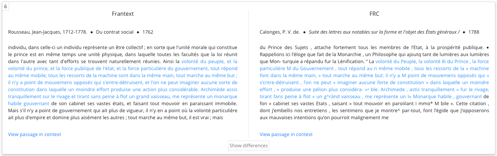

# TextPAIR (Pairwise Alignment for Intertextual Relations)

> "Nous ne faisons que nous entregloser" Montaigne wrote famously in his *Essais*... Since all we do is gloss over what's already been written, we may as well build a tool to detect these intertextual relationships...

TextPAIR is a scalable and high-performance sequence aligner for humanities text analysis designed to identify "similar passages" in large collections of texts. These may include direct quotations, plagiarism and other forms of borrowings, commonplace expressions and the like. It compares texts by their shared word-sequence shingles, then loads the similar passages into a web application to search and browse them.



## Documentation

**<https://artfl-project.github.io/text-pair/>**

- [Installation](https://artfl-project.github.io/text-pair/installation.html): Docker, Linux, or macOS
- [Running an alignment](https://artfl-project.github.io/text-pair/running.html)
- [Configuring the alignment](https://artfl-project.github.io/text-pair/configuration.html)
- [The web application](https://artfl-project.github.io/text-pair/web-app.html)
- [Output files](https://artfl-project.github.io/text-pair/output.html)
- [Papers and talks](https://artfl-project.github.io/text-pair/references.html)

## Quick start

```console
./install.sh                                          # see the installation guide for PostgreSQL setup
cp /var/lib/text-pair/config/sa_config.ini my_config.ini   # set source_file_path, and target_file_path to compare two collections
textpair --config=my_config.ini --workers=8 my_database
```

## License

TextPAIR is released under the [GNU General Public License v3](LICENSE).

Built with support from the Mellon Foundation and the Fondation de la Maison des Sciences de l'Homme.
