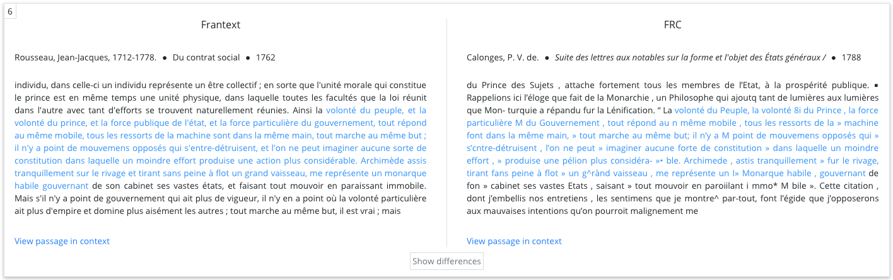

# TextPAIR
{: .fs-9 }

Pairwise Alignment for Intertextual Relations
{: .fs-6 .fw-300 }

> "Nous ne faisons que nous entregloser" Montaigne wrote famously in his *Essais*... Since all we do is gloss over what's already been written, we may as well build a tool to detect these intertextual relationships...

TextPAIR is a scalable and high-performance sequence aligner for humanities text analysis designed to identify "similar passages" in large collections of texts. These may include direct quotations, plagiarism and other forms of borrowings, commonplace expressions and the like. It is a complete rewrite and rethink of the [original implementation](https://code.google.com/archive/p/text-pair/) released in 2009.

## How it works

While TextPAIR was developed in response to the fairly specific phenomenon of similar passages across literary works, the sequence analysis techniques it employs were developed in widely disparate fields, such as bioinformatics and computer science, with applications ranging from genome sequencing to plagiarism detection.

TextPAIR generates a set of overlapping word sequence shingles for every text in a corpus, then stores and indexes that information to be analyzed against shingles from other texts. For example, the opening declaration from Rousseau's *Du Contrat Social*,

> L'homme est né libre, et partout il est dans les fers. Tel se croit le maître des autres, qui ne laisse pas d'être plus esclave qu'eux,

would be rendered in trigram shingles (with lemmatization, accents flattened and function words removed) as:

```
homme_libre_partout, libre_partout_fer, partout_fer_croire, fer_croire_maitre, croire_maitre_laisser, maitre_laisser_esclave
```

Common shingles across texts indicate many different types of textual borrowings, from direct citations to more ambiguous and unattributed usages of a passage. The results are loaded into a web application where you can search and browse the similar passages shared between different texts in one collection, or across two collections, as in the example below.



## Where to go next

- [Installation](installation.html): Docker, Linux, or macOS.
- [Running an alignment](running.html): the `textpair` command and its options.
- [Configuring the alignment](configuration.html): the settings that matter most.
- [The web application](web-app.html): adjusting labels, search fields and citations.
- [Output files](output.html): the alignment results on disk.
- [Papers and talks](references.html) about TextPAIR and its predecessors.
